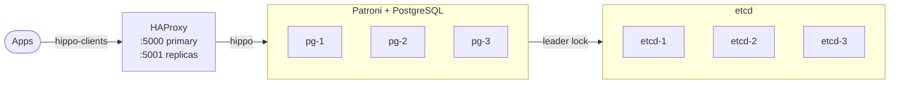

<!--
SPDX-License-Identifier: MIT
Copyright: 2026 NiceBots.xyz
-->
# hippo

Highly available PostgreSQL 18 for Docker Swarm, built on Patroni, etcd and HAProxy and deployed with a
single `docker stack deploy`.



> [!NOTE]
> hippo is pre-1.0, so a minor release may still change the stack contract.

## Images

`ghcr.io/nicebots-xyz/hippo`, for amd64 and arm64.

| Tag | Contents | Moves |
|---|---|---|
| `18` | PostgreSQL 18 with its contrib extensions, and Patroni | with each release |
| `18-ext` | `18` plus the extensions below | with each release |
| `18-<version>`, `18-ext-<version>` | a single release | never |

Releases follow their own semver, independent of PostgreSQL:

| Bump | When |
|---|---|
| major | breaking change to the stack or its configuration |
| minor | new extension or feature, Patroni minor |
| patch | dependency updates, PostgreSQL 18.x minors included |

### Extensions in `18-ext`

| Extension | Preload |
|---|---|
| [pgvector](https://github.com/pgvector/pgvector) | |
| [pg_cron](https://github.com/citusdata/pg_cron) | required |
| [pg_partman](https://github.com/pgpartman/pg_partman) | for its background worker |
| [pgaudit](https://github.com/pgaudit/pgaudit) | required |
| [pg_repack](https://github.com/reorg/pg_repack) | |
| [hypopg](https://github.com/HypoPG/hypopg) | |
| [pg_stat_kcache](https://github.com/powa-team/pg_stat_kcache) | required, with `pg_stat_statements` |

Extensions ship installed and disabled, and `CREATE EXTENSION` enables one. Those needing a preload first
go into `shared_preload_libraries`, with [`patronictl`](#operate):

```bash
patronictl edit-config --force -p shared_preload_libraries=pg_stat_statements,pg_cron
```

```bash
patronictl restart --pending --force hippo
```

## Deploy

Requirements:

- a Swarm with exactly three nodes labelled `hippo.pg=true`
- IP protocol 50 (ESP) allowed between nodes, since both overlay networks are encrypted

Label the nodes and create the secrets:

```bash
docker node update --label-add hippo.pg=true <node>
```

```bash
openssl rand -hex 32 | docker secret create hippo_superuser_password_v1 -
```

```bash
openssl rand -hex 32 | docker secret create hippo_replication_password_v1 -
```

Fetch the stack of a [release](https://github.com/nicebots-xyz/hippo/releases) and deploy it with the
matching image, pinned by digest so every node runs the same build:

```bash
git clone --depth 1 --branch hippo@<version> https://github.com/nicebots-xyz/hippo && cd hippo/deploy
```

```bash
export HIPPO_IMAGE=ghcr.io/nicebots-xyz/hippo@$(docker buildx imagetools inspect ghcr.io/nicebots-xyz/hippo:18-<version> --format '{{ .Manifest.Digest }}')
```

```bash
docker stack deploy -c stack.yml hippo
```

The same stack works unchanged from Komodo or Portainer. Its variables:

| Variable | Default |
|---|---|
| `HIPPO_IMAGE` | required |
| `HIPPO_SUBNET` | `10.77.0.0/24` |
| `HIPPO_NETWORK` | `hippo` |
| `HIPPO_CLIENT_NETWORK` | `hippo-clients` |
| `HIPPO_SUPERUSER_SECRET` | `hippo_superuser_password_v1` |
| `HIPPO_REPLICATION_SECRET` | `hippo_replication_password_v1` |

## Connect

Apps join the `hippo-clients` network, where HAProxy is the only service:

| Address | Routes to |
|---|---|
| `haproxy:5000` | the primary |
| `haproxy:5001` | the replicas, round robin |

During a failover connections fail fast instead of hanging, for about 4 s at worst. Clients should retry
with backoff on SQLSTATE `08xxx`, `57P01` and `25006`, and transactions in flight on the old primary
always need a retry from the app.

Trusted services on the `hippo` network can skip HAProxy with libpq and
`host=pg-1,pg-2,pg-3 target_session_attrs=read-write`. A single name such as `host=pg` does not work
there: on a read-only server, libpq skips the remaining addresses of that name.

## Operate

`patronictl` runs inside the `pg` tasks. From a labelled node:

```bash
alias patronictl='docker exec -i $(docker ps -qf label=com.docker.swarm.service.name=hippo_pg | head -1) patronictl -c /etc/patroni.yml'
```

```bash
patronictl list
```

| Task | How |
|---|---|
| Update | redeploy with the new `HIPPO_IMAGE`; Swarm restarts one member at a time and Patroni fails over around each leader restart |
| Change PostgreSQL settings | `patronictl edit-config`, as Patroni keeps them in etcd after bootstrap |
| Change a config or secret | add a new version (`patroni_v3`, `…_v2`) and point the service at it, since both are immutable |

A lost node's slots stay pending instead of moving elsewhere, as their data is node local.

Not covered yet: backups, PgBouncer, PostgreSQL majors other than 18, and major upgrades, which stay a
manual `pg_upgrade`.

## How it works

`pg` and `etcd` are each a single replicated service with three replicas.

| Concern | Mechanism |
|---|---|
| Member identity | `hostname: "pg-{{.Task.Slot}}"`, resolvable on the overlay and following IP changes |
| Data | node local volumes named `pgdata-{{.Task.Slot}}` and `etcd-data-{{.Task.Slot}}` |
| Placement | `max_replicas_per_node: 1` on the labelled nodes, so slots never wander |
| Discovery | `endpoint_mode: dnsrr`; HAProxy follows Docker DNS and Patroni's `/primary` and `/replica` checks |
| Health | checks never depend on peers, since Swarm publishes a task's DNS names only once it is healthy |
| Rollouts | `parallelism: 1`, `order: stop-first`, `stop_grace_period: 120s` |
| Configuration | Patroni YAML as a `template_driver: golang` Docker config, passwords through `{{ secret }}` |
| Isolation | etcd and Patroni's REST API stay on `hippo`; state changing REST calls are accepted from members only |

etcd runs the stock upstream image, configured through `ETCD_*` variables alone.

## Development

```bash
docker buildx bake
```

```bash
tests/smoke/run.sh hippo-dev/hippo:18
```

`docker buildx bake` builds both images; `ext` builds on the `base` target of the same build. The smoke
test deploys `deploy/stack.yml` on a throwaway three node Swarm made of privileged docker-in-docker
containers, rolls every Postgres member under write load and fails on any lost acknowledged write.

Every pin has a single home, and Renovate keeps it current:

| Pin | File |
|---|---|
| `postgres:18` base image | `images/base/Dockerfile` |
| Patroni and its Python dependencies | `images/base/requirements.lock` |
| PGDG extensions | `images/ext/extensions.yaml` |
| etcd and HAProxy | `deploy/stack.yml` |

Extension updates flagged `upgrade: alter` may need `ALTER EXTENSION … UPDATE` and get a manual review.

### Releases

[Tegami](https://github.com/fuma-nama/tegami) releases the base image as the `hippo` line and ext as
`hippo-ext`, and a base release always releases ext too. A pull request changing `images/`,
`deploy/` or `docker-bake.hcl` carries a changelog entry in `.tegami/`, generated for Renovate.

Each push to `main` with pending entries builds and tests candidate images and opens the Version PR.
Merging it promotes those exact digests to the release tags without a rebuild, then tags the commit and
publishes the GitHub release. Any failed check stops the pipeline:

| Check | Asserts |
|---|---|
| Change = entry | a pull request touching shipped content has a `.tegami/` entry |
| Pins = contents | the image's `dpkg-query` and `pip freeze` match the pin files exactly |
| SBOM = contents | every file, package and component of the image is in its SBOM, with a license |
| Candidate = tree | the line's inputs are unchanged since the candidate was built |
| Published = candidate | every release tag resolves to the candidate digest |

## License

The code is [MIT](LICENSE) licensed, with SPDX headers checked by
[licensor](https://github.com/nicebots-xyz/licensor).

The images bundle third party software under its own licenses, and the stack runs etcd (Apache-2.0) and
HAProxy (GPL-2.0) from their unmodified upstream images. Each published image carries SPDX SBOM and build
provenance attestations:

```bash
docker buildx imagetools inspect ghcr.io/nicebots-xyz/hippo:18 --format '{{ json .SBOM }}'
```

| License texts of | Location |
|---|---|
| Debian packages, PostgreSQL and the extensions included | `/usr/share/doc/<package>/copyright` |
| Python packages | `/opt/patroni/lib/python3.13/site-packages/<package>.dist-info/` |
| Components no package manager owns | [`images/base/hippo/components.yaml`](images/base/hippo/components.yaml) |
