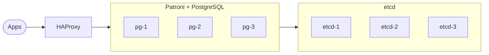

<!--
SPDX-License-Identifier: MIT
Copyright: 2026 NiceBots.xyz
-->
# hippo

Highly available PostgreSQL 18 for Docker Swarm, built on Patroni, etcd and HAProxy and deployed with a
single `docker stack deploy`.



> [!NOTE]
> hippo is pre-1.0, so a minor release may still contain breaking changes.

## Images

| Image | Contents |
|---|---|
| `ghcr.io/nicebots-xyz/hippo:18` | PostgreSQL 18 with its contrib extensions, and Patroni |
| `ghcr.io/nicebots-xyz/hippo:18-ext` | `18` plus [pgvector](https://github.com/pgvector/pgvector), [pg_cron](https://github.com/citusdata/pg_cron), [pg_partman](https://github.com/pgpartman/pg_partman), [pgaudit](https://github.com/pgaudit/pgaudit), [pg_repack](https://github.com/reorg/pg_repack), [hypopg](https://github.com/HypoPG/hypopg) and [pg_stat_kcache](https://github.com/powa-team/pg_stat_kcache) |

Each release also has immutable `18-<version>` and `18-ext-<version>` tags. Extensions are installed but
not enabled, and pg_cron, pgaudit and pg_stat_kcache need `shared_preload_libraries`.

## Deploy

Requirements:

- a Swarm with exactly three nodes labelled `hippo.pg=true`
- IP protocol 50 (ESP) allowed between nodes

```bash
docker node update --label-add hippo.pg=true <node>
```

```bash
openssl rand -hex 32 | docker secret create hippo_superuser_password_v1 -
```

```bash
openssl rand -hex 32 | docker secret create hippo_replication_password_v1 -
```

```bash
git clone --depth 1 --branch hippo@<version> https://github.com/nicebots-xyz/hippo && cd hippo/deploy
```

```bash
export HIPPO_IMAGE=ghcr.io/nicebots-xyz/hippo@$(docker buildx imagetools inspect ghcr.io/nicebots-xyz/hippo:18-<version> --format '{{ .Manifest.Digest }}')
```

```bash
docker stack deploy -c stack.yml hippo
```

| Variable | Default |
|---|---|
| `HIPPO_IMAGE` | required |
| `HIPPO_SUBNET` | `10.77.0.0/24` |
| `HIPPO_NETWORK` | `hippo` |
| `HIPPO_CLIENT_NETWORK` | `hippo-clients` |
| `HIPPO_SUPERUSER_SECRET` | `hippo_superuser_password_v1` |
| `HIPPO_REPLICATION_SECRET` | `hippo_replication_password_v1` |

Updating means redeploying with a new `HIPPO_IMAGE`. PostgreSQL settings live in etcd after bootstrap
and are changed with `patronictl edit-config`.

## Connect

Apps join the `hippo-clients` network.

| Address | Routes to |
|---|---|
| `haproxy:5000` | the primary |
| `haproxy:5001` | the replicas |

## Not yet included

- backups
- PgBouncer
- PostgreSQL majors other than 18

## Development

```bash
docker buildx bake
```

```bash
tests/smoke/run.sh hippo-dev/hippo:18
```

Pull requests changing `images/`, `deploy/` or `docker-bake.hcl` need a changelog entry in `.tegami/`.

## License

[MIT](LICENSE). The images bundle third party software under its own licenses, listed in each image's
SBOM attestation.
